# Лабораторна робота 1-2

### Тема: Створення консольного застосунку на Dart

### Мета:

Навчитися створювати консольний застосунок мовою Dart: описувати предметну область класами, отримувати дані з відкритого REST API, зберігати їх у файл формату JSON та відновлювати під час наступного запуску.

### Варіант 4

Кулінарна книга рецептів

### Про API

Для отримання даних використовується відкритий REST API **TheMealDB** ([themealdb.com/api.php](https://www.themealdb.com/api.php)) — база рецептів страв з усього світу. Дані віддаються у форматі JSON, запити виконуються методом `GET`.

**Базовий URL**

```text
https://www.themealdb.com/api/json/v1/1/search.php?s=pasta
```

**Структура відповіді.** Відповідь — JSON-об'єкт з єдиним ключем `meals`. Його значення — масив об'єктів-страв, а якщо нічого не знайдено, то `null`.

```json
{
  "meals": [
    {
      "idMeal": "52777",
      "strMeal": "Mediterranean Pasta Salad",
      "strCategory": "Seafood",
      "strArea": "Italian",
      "strInstructions": "Bring a large saucepan of salted water...",
      "strMealThumb": "https://www.themealdb.com/images/media/meals/wvqpwt1468339226.jpg",
      "strTags": "Pasta,Baking",
      "strYoutube": "https://www.youtube.com/watch?v=e52IL8zYmaE",
      "strIngredient1": "mozzarella balls",
      "strMeasure1": "200 g",
      "strSource": "https://thelemonsqueezy.com/recipe/mediterranean-pasta-salad/",
      "strImageSource": null,
      "strCreativeCommonsConfirmed": null,
      "dateModified": null
    }
  ]
}
```

**Поля об'єкта страви:**


| Поле                                                            | Опис                                                        |
| --------------------------------------------------------------- | ----------------------------------------------------------- |
| `idMeal`                                                        | унікальний ідентифікатор страви                             |
| `strMeal`                                                       | назва страви                                                |
| `strMealAlternate`                                              | альтернативна назва (часто `null`)                          |
| `strCategory`                                                   | категорія (Seafood, Dessert тощо)                           |
| `strArea`                                                       | кухня або регіон походження (Italian тощо)                  |
| `strCountry`                                                    | країна походження                                           |
| `strInstructions`                                               | інструкція приготування, кроки розділені `\r\n`             |
| `strMealThumb`                                                  | посилання на зображення страви                              |
| `strTags`                                                       | теги через кому                                             |
| `strYoutube`                                                    | посилання на відеорецепт                                    |
| `strIngredient1` … `strIngredient20`                            | інгредієнти (до 20), невикористані слоти порожні або `null` |
| `strMeasure1` … `strMeasure20`                                  | кількість для відповідного інгредієнта                      |
| `strSource`                                                     | першоджерело рецепта                                        |
| `strImageSource`, `strCreativeCommonsConfirmed`, `dateModified` | службові поля (у прикладі `null`)                           |


# lab_dart

Невеликий консольний застосунок на Dart. Кулінарна книга рецептів.
Дані зберігаються локально у `data.json`, додаткові страви можна підвантажити
з публічного API [TheMealDB](https://www.themealdb.com/api.php).

## Запуск

```bash
dart pub get
dart run bin/lab_dart.dart
```


## Головне меню

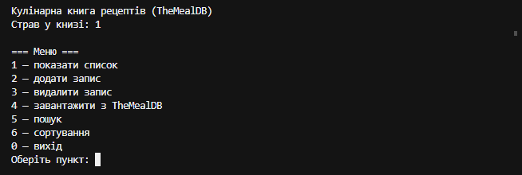

Після кожної операції програма чекає **Enter**, потім очищає консоль і знову показує меню.

## Приклади роботи


### Список і ручне додавання

```bash
dart run bin/lab_dart.dart
# 2 → ввести назву, категорію, кухню…
# 1 → показати список
```


### Ручне додавання запису

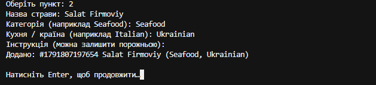

---

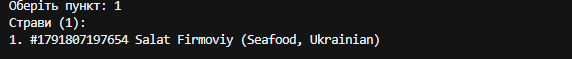

### Завантаження з TheMealDB

У меню оберіть `4`, введіть наприклад `apple pie`.

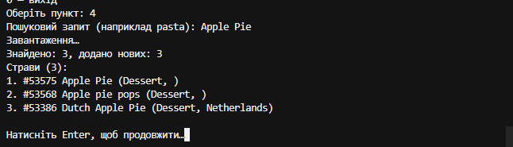

### Пошук

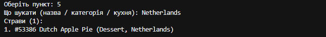

### Сортування

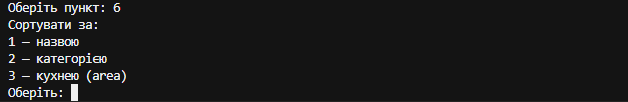

### До:

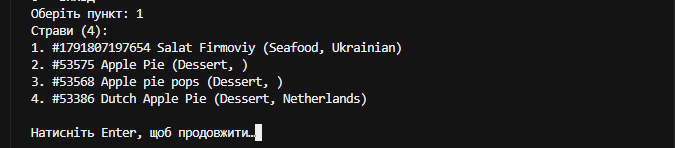

### Після:

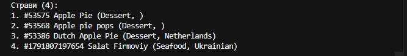

### Видалення

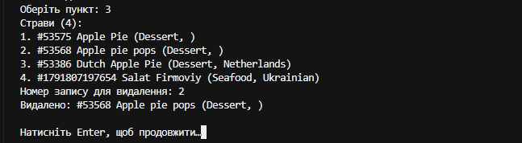

Приблизний вигляд рядка страви у списку:

```text
3. #53386 Dutch Apple Pie (Dessert, Netherlands)
```


## Структура

```
lab_dart/
├── bin/
│   └── lab_dart.dart       точка входу: текстове меню
├── lib/
│   ├── lab_dart.dart       публічний API пакета (експорти)
│   └── src/
│       ├── api.dart        HTTP-клієнт TheMealDB (пакет http)
│       ├── models.dart     Meal, Ingredient, MealResponse, SortBy, Storable
│       ├── meals.dart      пошук і сортування (чисті функції)
│       └── repository.dart читання/запис data.json
└── test/
    ├── api_test.dart       MockClient без реального запиту
    ├── meals_test.dart     пошук і сортування
    └── models_test.dart    toJson / fromJson / FormatException
   
```

Логіка розділена так, щоб мережа була в `api.dart`, файл — у `repository.dart`,
а пошук/сорт у `meals.dart` — чисті функції над моделями, тому їх зручно тестувати
без інтернету. У `MealApi` клієнт передається через конструктор (`http.Client`),
тож у тестах підставляється `MockClient`.

## Що використано з мови

- `dart:io` — `File`, `stdin` / `stdout`, очищення консолі
- `dart:convert` — `jsonDecode`, `JsonEncoder`
- `package:http` — `http.get`, `http.Client`
- `async` / `await`, `Future`
- null safety — `String?`, `??`, pattern matching (`if (json case {…})`)
- абстрактний клас `Storable` з `toJson()`
- `enum SortBy` для сортування
- колекції — `where`, `map`, `sort`, колекційний `for`
- `try` / `catch` для мережі, JSON і некоректного вводу
- `package:test` + `package:http/testing.dart` (`MockClient`)


## Тести

```bash
dart test
```

Тести покривають:

- `toJson()` / `fromJson()` (у тому числі формат TheMealDB з `strIngredientN`);
- некоректні дані → `FormatException`;
- локальний пошук і сортування;
- розбір відповіді API через `MockClient` (без реального запиту);
- помилковий `statusCode` і `"meals": null`.

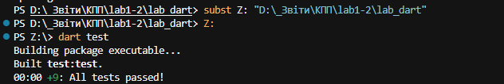

## Перевірка стилю

```bash
dart format .
dart analyze
```

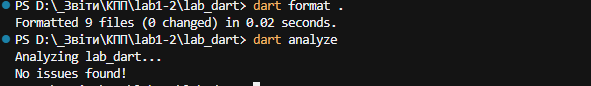

Налаштування аналізатора — у `analysis_options.yaml`.